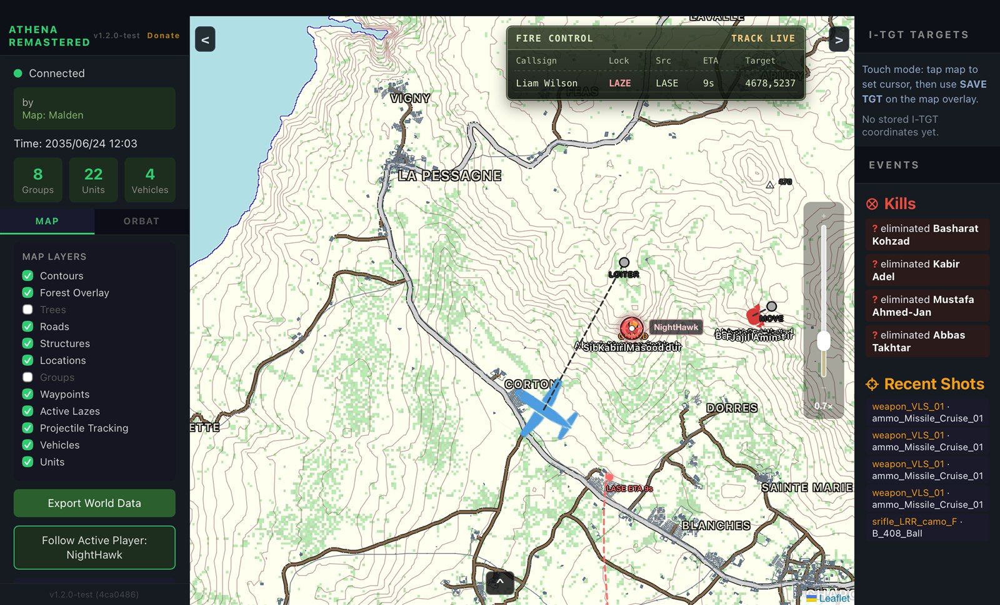
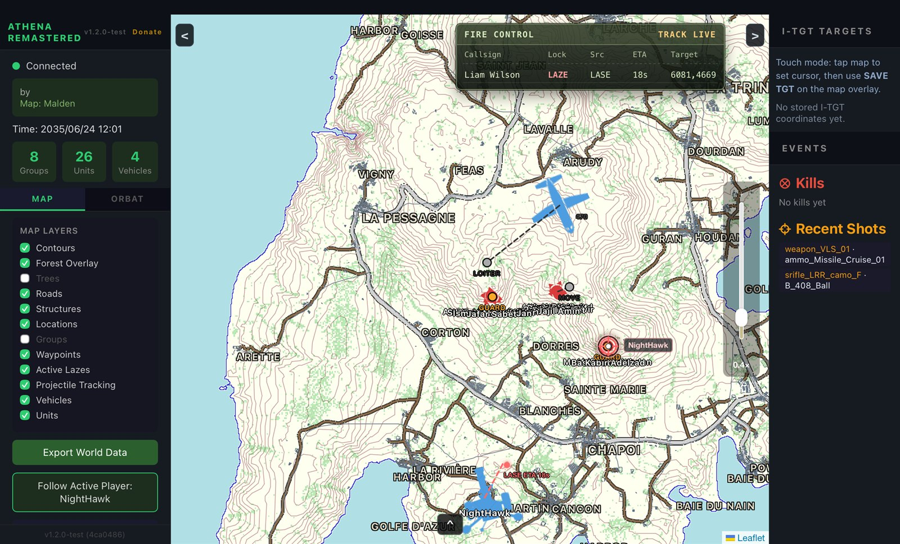
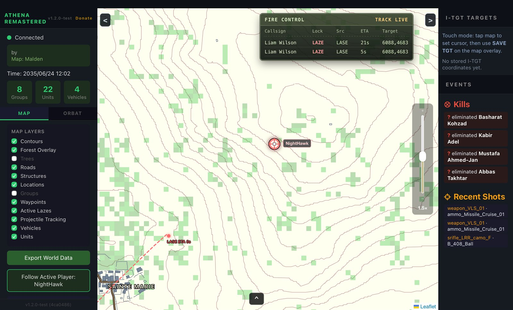
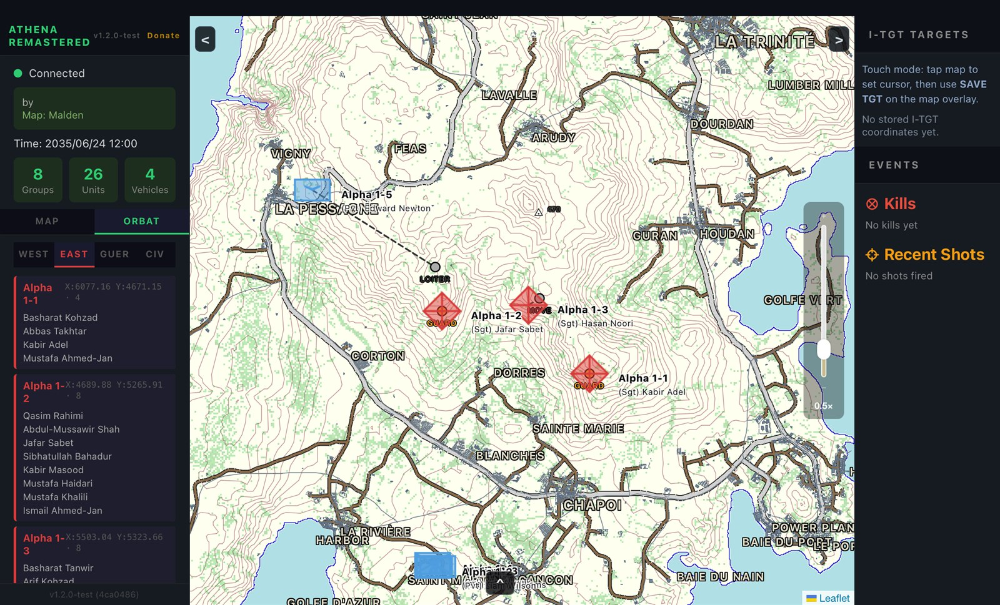

# Athena Remastered v1.2.1

Hotfix for v1.2.0: Athena did not start in missions. This release fixes that and makes Athena much lighter on your game. Everyone on v1.2.0 should update.

## What's fixed in v1.2.1

- Athena starts again in every mission
- No more FPS loss: live updates now run 4 times per second instead of every frame (tested with 66 units and 15 vehicles: same FPS as without Athena)
- Exporting a large map no longer freezes the game
- Tablets: projectile paths and the Fire Control panel show live, even when the tablet clock is a few seconds off
- Tablets: the map reconnects by itself after the screen was off (no F5 needed)
- M5 Sandstorm / artillery: follow-up shots use the real impact point and time of flight
- Per-shot debug logging is off by default

Thanks to Mrakos for the performance analysis.

> **Do not load Bus's original Athena mod** (*Athena - An Arma 2nd Screen Application*) at the same time as Athena Remastered. Both use the same internal name and get in each other's way.

## Screenshots

Live on an iPad during a test mission on Malden.


*A cruise missile from the Mk41 VLS on its way to a laser spot. Fire Control shows the shooter, lock type and live ETA, with the kill feed on the right.*


*Overview: a UCAV Sentinel lases an enemy position while a missile is on its way.*


*Two missiles in flight to the same laser spot, each with its own ETA.*


*ORBAT: enemy groups with coordinates and unit lists, and their group markers and waypoints on the map.*

## Quick Start

### What you need

- A Windows 10/11 PC that runs Arma 3
- Optional: a phone or tablet on the same Wi-Fi/network as the PC
- Optional: **Athena Desktop** by Bus. If a map was ever exported with it, Athena Remastered uses that export for the forest overlay.

The easiest way to install is the [Steam Workshop item](https://steamcommunity.com/sharedfiles/filedetails/?id=3687225607). Use the download below if you don't use the Workshop.

### Install from this release

1. Scroll down to **Assets** and download **AthenaRemastered-v1.2.1.zip**.
2. Right-click the zip, choose **Properties**, check **Unblock** (if shown) and click **OK**. Then extract it.
3. Move the extracted **@AthenaRemastered** folder to your Arma 3 folder, for example `C:\Program Files (x86)\Steam\steamapps\common\Arma 3\@AthenaRemastered`.
4. In the Arma 3 Launcher: **Mods** → **...** → **Add local mod...** → select the `@AthenaRemastered` folder. Untick the Workshop version of Athena Remastered if you also have it.

### Start Athena Remastered

1. Run `@AthenaRemastered\Server\AthenaRemastered.Server.exe`. A console window opens; **keep it open while you play**.
2. If Windows Firewall asks for access, allow it on **private networks** (needed for phones and tablets).
3. Open the map in your browser:
   - On the same PC: **http://localhost:5000**
   - On a phone or tablet: `http://<your-pc-ip>:5000` (the console prints the address)
4. Start Arma 3 with the mod and **`-noBE`** (BattlEye off, see below), then start a mission. The map shows a welcome screen until the mission is running.

### First time on a new map

The first time you play a map, Athena Remastered exports it from the game (roads, buildings, forests, terrain). The browser shows the progress; this can take a few minutes on large maps. The export is saved in `Documents\AthenaRemastered\MapCache` and reused next time, also after updates.

### BattlEye

The `AthenaServer_x64.dll` extension is not on BattlEye's allowlist. Use **`-noBE`** for singleplayer and LAN, or play on servers without BattlEye. The DLL is unchanged since v1.1.5.

### Troubleshooting

| Problem | What to do |
|---|---|
| The page does not load | Make sure the server console is open, wait a few seconds, then refresh. |
| The map stays on the welcome screen | Start or join a mission. The map only appears while a mission is running (not in the main menu or editor). |
| Nothing happens in Arma | Check that the mod is loaded (Launcher → Mods), that Arma was started with `-noBE`, and that Bus's original Athena mod is **not** loaded at the same time. |
| Phone or tablet cannot connect | Use the PC's IP address (not `localhost`), make sure the device is on the same network, and allow the server in Windows Firewall on private networks. |
| A map is exported again every time | Check that `Documents\AthenaRemastered\MapCache` exists and is writable. The server console prints which cache folder it uses. |

## Windows SmartScreen

If you see "Windows protected your PC" when starting the server:

1. Click **More info**.
2. Click **Run anyway**.

Or unblock the zip before extracting (see Install step 2). PowerShell alternative:

```powershell
Get-ChildItem -Recurse .\@AthenaRemastered | Unblock-File
```

Only download Athena Remastered from this GitHub Releases page or the Steam Workshop.

## Also in this version (from v1.2.0)

### New map look

- Map rendering from Athena Web 2: classic Athena colours, smoothed coastlines and contour lines, airport surfaces, tree markers, and the classic Athena vehicle silhouettes for every vehicle
- Sidebars can be collapsed with the `<` / `>` buttons, and there is a tablet layout
- I-TGT target capture: press **T** or the middle mouse button (or **SAVE TGT** on a tablet) to store a target; the right panel lists your targets
- Follow Player switches off automatically when you pan or zoom yourself
- Flat icons for the Kills and Recent Shots lists
- The "Loaded from cache" box disappears after a few seconds

### Fixes

- The map no longer shows the last-used map while Arma is still in the main menu
- Exported maps are kept in `Documents\AthenaRemastered\MapCache`, so they're no longer exported again after an update. Existing exports are copied over automatically.
- The forest overlay is no longer far too dense. With an Athena Desktop export it matches Athena Web 2 exactly.
- Every shot appeared twice in Recent Shots
- Crew labels showed "P:" for everyone; they now show the real seat (D: driver, G: gunner, C: commander)
- Drones, turrets and radars no longer show as a large tilted rectangle
- M5 Sandstorm / artillery: after impact, the projectile path jumps to the real impact point and time of flight, and follow-up shots in the same direction use it
- The version label in the sidebar header is no longer cut off

## Known Limitations

- BattlEye: use `-noBE` (singleplayer / LAN / servers without BattlEye)
- Projectile tracking with a laze works well. Without a laze, the first shot of a fire mission is still a fixed-range guess; real in-flight tracking is planned.
- Map styles Ground and Pilot are being reworked
